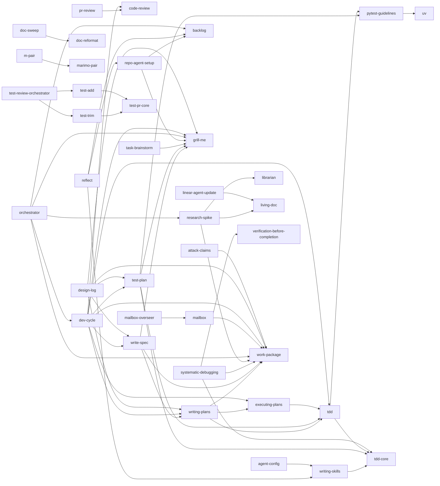

# Agent config

One source checkout for my AI coding agent setup - rules, skills, commands, hooks and harness settings - synced into Claude Code, Codex, Opencode, Pi, Goose, Antigravity and no-mistakes.

```
this repo (source)  --agent-config sync-->  native homes (~/.claude, ~/.codex, ~/.config/opencode, ...)
```

Edit here, never in the native homes. Native homes keep their own sessions, credentials, trust, caches and local settings; sync merges only the keys and files this repo declares.

## Setup

```bash
git clone --recurse-submodules git@github-haydeni0:Haydeni0/agent-config.git ~/gitrepos/agent-config
cd ~/gitrepos/agent-config
uv tool install --editable ./settings-sync
mkdir -p ~/.config/agent-config
printf 'source = "%s/gitrepos/agent-config"\n' "$HOME" > ~/.config/agent-config/config.toml
agent-config sync && agent-config check && agent-config doctor
```

An existing installation adopts cleanly on first sync: identical native files are adopted, local-only state is preserved. Source lookup order: `--source`, `AGENT_CONFIG_REPO`, then the `config.toml` above; none set is an error.

## Daily use

```bash
agent-config sync                    # apply source to every native home
agent-config sync codex              # one harness
agent-config sync codex agents-md    # one step
agent-config check                   # read-only drift check
agent-config doctor                  # paths, links, host CLIs
agent-config bootstrap [harness]     # install external packages (--dry-run to preview)
bash scripts/verify.sh               # full test suite, same as CI
```

- **Changing config:** edit source here -> `agent-config sync` -> `agent-config check` -> `bash scripts/verify.sh`.
- **Updating a machine:** `git pull && git submodule update --init`, then `agent-config sync` and `check`. Bump package pins deliberately, then `agent-config bootstrap <harness>`.
- **Python dependency changes** need the editable tool refreshed, or run via lockfile: `uv run --locked --directory settings-sync agent-config`.

Bootstrap defaults to installed hosts; no-mistakes needs explicit selection because installing it starts its daemon. `sync.sh` and the bare `sync` command are compatibility entry points. Full flags and per-harness mechanics: [settings-sync/README.md](settings-sync/README.md).

## Layout

| Path | Contents |
|---|---|
| `rules/global.md` | Shared instructions, rendered into each harness's global rules file |
| `skills/`, `commands/`, `agents/` | Shared agent resources |
| `harnesses/<harness>/` | Per-harness settings templates and resources |
| `hooks/` | Shared command-safety policy and native adapters |
| `custom/` | Claude hook scripts; pinned plugin submodules under `custom/plugins/` |
| `settings-sync/` | The `agent-config` CLI |
| `opencode-resume/` | Opencode-session-to-Claude transcript converter |
| `scripts/` | `verify.sh`, `bootstrap.sh`, skill and package lints |
| `docs/requirements.md` | Binding requirements, with verification pointers |
| `AGENTS.md`, `CLAUDE.md`, `MEMORY.md` | Instructions and lessons for agents editing this repo |
| `.agents/` | Machine-local work packages and backlog (gitignored) |

## What stays local

- **Native state:** Codex trust, hook approvals and UI state; Gemini workspace trust; all credentials and sessions.
- **Overlays** in `$XDG_CONFIG_HOME/agent-config/overlays/`: `no-mistakes.yaml` for machine-only no-mistakes settings; `claude.json` `permissions.allow` entries, appended to the shared Claude permissions.
- **Shell, editor and OS config** belong in the [dotfiles repo](https://github.com/Haydeni0/dotfiles); `~/.zshenv` stays machine-local.

## Typical workflows

> Personal notes. One conversation per task unless context goes stale or the repo changes.

- **Feature:** `/dev-cycle <topic>` runs the full pipeline in a work package (`.agents/work/<date>-<topic>/`): grill -> test-plan -> launch gate -> spec -> plan -> implement (tdd) -> code-review -> verify-fix -> report. Human-in-loop until the gate's `go`, autonomous after. Small changes: `/grill-me` -> `/write-spec` -> `/writing-plans` -> `/tdd`, same package.
- **Review:** `/code-review` on any uncommitted diff, branch or PR. `/codebase-review` for a structural pass with no diff.
- **Debug:** `/systematic-debugging` for bugs that resist a first fix; opens a debug package on the first failed fix and survives compaction.
- **Backlog:** off-scope issues get captured mid-task, never fixed unprompted; `/backlog` recalls them, and they surface at session start.
- **Research before design:** `/research-spike <question>` fans out investigation streams (capped at 6 in flight), each writing a finalised living-doc file into a work-package, synthesized into the package's `context.md` plus decision-ready Q entries in `decisions.md`.
- **Harness config and skills:** `/agent-config`. New skills follow `writing-skills`; frontmatter (`deps`, `exits`, `layer`) is machine-checked by `scripts/check-skills.py`.

## Skills

<details>
<summary><b>Design and build</b></summary>

- `dev-cycle` - whole pipeline as one state-machine run
- `grill-me` - one fork at a time, decision log
- `design-log` - when to write design entries; promotes settled rules
- `test-plan` - scenario plan before implementation
- `write-spec` - spec from settled design
- `writing-plans` / `executing-plans` - checkbox plan; execute it
- `tdd` / `tdd-core` - red-green loop and good-test canon
- `pytest-guidelines` - test-writing standards and red flags
- `verification-before-completion` - evidence before "done"
- `orchestrator` - waves of independent units on subagents, for long unattended runs
- `stack-pr` - stacked PRs, map at `.agents/stacks/<slug>.json`
- `pr-description` - PR body from branch diff

</details>

<details>
<summary><b>Review</b></summary>

- `code-review` - any diff or PR; verdict gate
- `pr-review` - resolves scope, dispatches code-review, writes the file
- `codebase-review` - structural pass over a module
- `ponytail-review` - over-engineering only; lists cuts
- `test-add` / `test-trim` / `test-review-orchestrator` - coverage gaps, redundancy, both merged

</details>

<details>
<summary><b>Debug and research</b></summary>

- `systematic-debugging` - reproduce-first, root-cause phases
- `attack-claims` - adversarial claim verification: attacker subagents in waves, verifier-judged survivor report
- `librarian` - library answers with permalink evidence
- `fetch-paper` - paper to markdown
- `prototype` - throwaway artifact to elicit judgement before spec
- `living-doc` - evidence-grounded working doc

</details>

<details>
<summary><b>State and capture</b></summary>

- `work-package` - `.agents/work/` on-disk contract: layout, entries, markers, state line
- `backlog` - deferred-item capture and recall
- `task-brainstorm` - guided grill over a batch of tasks
- `handoff` - compact a session for the next agent
- `reflect` - session retro -> durable config change
- `doc-sweep` - repo-wide doc tidy, human-gated
- `tempfile` - one-shot dump to a scratch file

</details>

<details>
<summary><b>Output and notebooks</b></summary>

- `explain-diff` / `visual-explainer` - HTML explanations of diffs, systems, plans
- `doc-reformat` - reformat a wall-of-text doc with a zero-loss audit
- `python-notebook` - `# %%` cell format
- `m-pair` - local wrapper over `marimo-pair` for live marimo kernels

</details>

<details>
<summary><b>Harness and tooling</b></summary>

- `agent-config` - authoring rules and sync runbook
- `mailbox` - file mailbox linking running sessions in herdr panes
- `mailbox-overseer` - overseer pattern: this session plans, a worker orchestrator pane executes
- `writing-skills` - TDD for skills
- `repo-agent-setup` - install or audit the agent-first kit in a repo
- `typer` / `uv` - CLI and Python command rules
- `linear-agent-update` - Linear comment templates and format check
- `no-mistakes` - validate-and-push pipeline gate
- `test-pr-core` - shared reference for the test-review family

</details>

<details>
<summary><b>Modes and runbooks</b></summary>

- `caveman` / `ponytail` - terse-output and lazy-solution modes; `*-help` cards
- `kubectl` / `herdr` / `lavish` - read-only kubectl, terminal multiplexer, lavish-axi CLI

</details>

<details>
<summary><b>Vendored</b></summary>

Symlinks into `custom/plugins/*` submodules, never edited here: `caveman`, `caveman-commit`, `caveman-compress`, `caveman-help`, `caveman-review`, `jupyter-to-marimo`, `marimo-notebook`, `marimo-pair`, `worktrunk`, `wt-switch-create`.

</details>

### Dependency graph

Generated from each skill's `deps:` frontmatter; regenerate with `uv run --locked --directory settings-sync python ../scripts/check_skill_graph.py --write`. `verify.sh` fails on a stale graph. Edges are directives to load or invoke another skill; skills with no edges appear only as `%%` comments.

<details open>
<summary>Skill graph</summary>

<!-- skill-graph: generated by scripts/check_skill_graph.py - do not edit by hand -->


</details>

## More docs

| File | Covers |
|---|---|
| [settings-sync/README.md](settings-sync/README.md) | What syncs where, CLI flags, ownership and recovery, adding a harness |
| [hooks/README.md](hooks/README.md) | Hook coverage per harness, enforcement limits, tests, rollback |
| `harnesses/{codex,goose,no-mistakes,pi}/README.md` | Harness-specific notes |
| [opencode-resume/README.md](opencode-resume/README.md) | Resuming opencode sessions in Claude Code |
| [docs/requirements.md](docs/requirements.md) | Requirements contract |
| [AGENTS.md](AGENTS.md), [MEMORY.md](MEMORY.md) | Rules and lessons for agents working on this repo |
