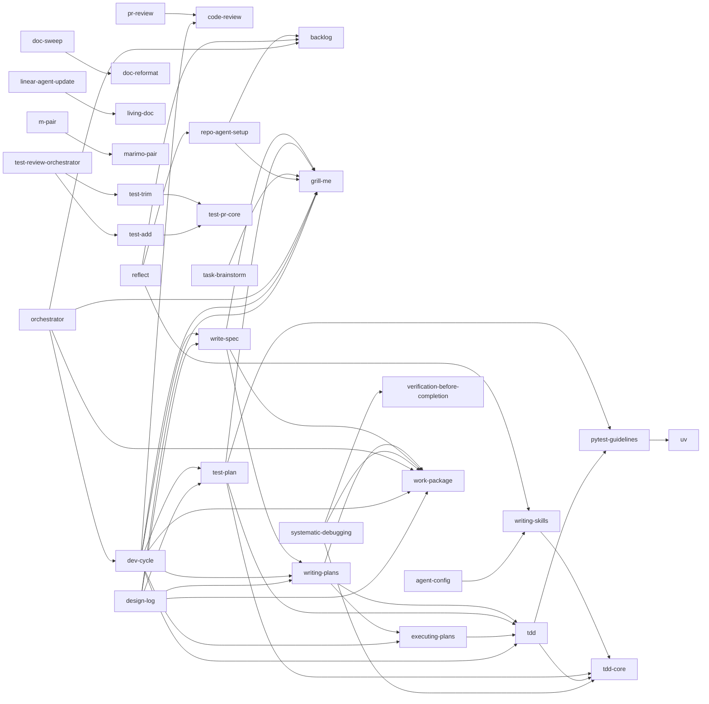

# Agent config

Shared configuration for Claude Code, Codex, Opencode, Pi, Goose, Antigravity, and no-mistakes. Source lives in `~/gitrepos/agent-config`; native homes retain sessions, credentials, caches, and local settings.

## Setup

```bash
git clone --recurse-submodules git@github-haydeni0:Haydeni0/agent-config.git ~/gitrepos/agent-config
cd ~/gitrepos/agent-config
uv tool install --editable ./settings-sync
mkdir -p ~/.config/agent-config
printf 'source = "%s/gitrepos/agent-config"\n' "$HOME" > ~/.config/agent-config/config.toml
agent-config sync
agent-config check
agent-config doctor
```

An existing installation adopts cleanly on first sync: identical native files are adopted, local-only state preserved. `--source /path/to/checkout` works before the local pointer exists. Source selection is explicit flag, `AGENT_CONFIG_REPO`, then `$XDG_CONFIG_HOME/agent-config/config.toml`. Unconfigured source is an error.

## Everyday commands

```bash
agent-config sync                         # local configuration and links
agent-config sync codex                   # one harness
agent-config sync codex agents-md         # one output
agent-config check                       # read-only drift check
agent-config doctor                      # paths, source/link health, host availability
agent-config bootstrap pi                # explicit external installation
agent-config bootstrap --dry-run         # show selected installed hosts
bash scripts/verify.sh                    # same checks as CI
```

`sync [harness] [step]` remains a compatibility command; `sync.sh` invokes bootstrap. Default bootstrap selects installed hosts. no-mistakes installation requires explicit selection because it starts its daemon. Pi/npm/Git and Evo pins are checked against installed versions; web-access uses its lockfile. Dependency changes require refreshing the editable uv tool environment. Lockfile alternative: `uv run --locked --directory settings-sync agent-config`.

## Source layout

| Path | Contents |
|---|---|
| `rules/global.md` | Complete shared instructions |
| `AGENTS.md`, `CLAUDE.md` | Repo editing instructions and Claude loader |
| `harnesses/<harness>/` | Shared native settings and resources |
| `skills/`, `commands/`, `agents/` | Shared agent resources |
| `custom/`, `hooks/` | Hook scripts and pinned plugin submodules |
| `settings-sync/`, `opencode-resume/` | Config CLI and session converter |
| `.agents/work/` | Machine-local design packages and plans, ignored |
| `.agents/backlog.md` | Local deferred topics, ignored |

Shared edits belong here. Runtime skill/command aliases point back here; generated instructions name this checkout. Mixed JSON/YAML/TOML files merge declared template keys and preserve other native keys. Generated outputs update normally after adoption; local edits conflict. Selected-step force backs up before replacement. Unknown entries survive cleanup. Details: [ownership and recovery](settings-sync/README.md#ownership-and-recovery).

Command hooks share one policy across native adapters. Hook-group sync preserves foreign registrations and local trust. See [hook coverage, tests and recovery](hooks/README.md) for verified hosts and enforcement limits.

Machine-only no-mistakes settings live in `$XDG_CONFIG_HOME/agent-config/overlays/no-mistakes.yaml`. Additional local Claude executable permissions live in `overlays/claude.json` as `permissions.allow`; they append uniquely to shared permissions. Codex trust, hook approvals and UI state remain in its native config. Gemini workspace trust remains native. Secrets stay outside this source checkout.

Shell/editor/OS configuration belongs in the [dotfiles repo](https://github.com/Haydeni0/dotfiles). Shared shell exports belong there; `~/.zshenv` remains machine-local. Add a sync target through one declaration in `settings-sync/settings_sync/registry.py` and its native adapter.

## Updating

Pull this checkout, initialize submodules, then run local sync and check. Update package pins deliberately, then run bootstrap for that harness. Git commit/push follow the user's current authorization gate.

## Typical workflows

> Personal notes. One conversation unless context stale or switching repos.

### Feature pipeline

- `/dev-cycle <topic>` runs the full pipeline as a work-package (`.agents/work/<date>-<topic>/`): grill -> test-plan -> launch gate -> spec -> plan -> implement (tdd) -> code-review -> verify-fix -> final report. Interview stages are human-in-loop; after the gate's `go` the zone is autonomous and reviewer verdicts are the only gates. Packages carry a machine-checked `state:` line - see the work-package skill for the byte contract.
- Manual variant (small changes): `/grill-me` for forks -> `/write-spec` -> `/writing-plans` -> `/tdd`, artifacts landing in the same package.

### Review

- `/code-review` on any uncommitted diff, branch diff, or PR - works locally with no PR required. `/codebase-review` for structural passes over a module or directory when there is no diff.

### Backlog

- Off-scope issues get captured mid-task, never fixed unprompted; `/backlog` recalls open items, surfaced at session start.

### Debug

- `/systematic-debugging` for bugs that resist a first fix: reproduce-first, root-cause phases; opens a lightweight debug package on the first failed fix and persists phase + fix counter across compaction.

### Research before design

- Fan out research subagents, collect findings under living-doc's evidence discipline, synthesize into a package's `context.md` plus decision-ready Q entries in `decisions.md`. Skill authoring queued; session template: `.agents/work/2026-10-14-agent-state-machine-spike/`.

### Harness config & skill authoring

- `/agent-config` - single source of truth is the source checkout: edit source in repo -> `agent-config sync <tool>` -> `bash scripts/verify.sh`. New skills follow writing-skills; the frontmatter contract (deps, exits, layer) is machine-checked by check-skills.

## Skill map

The dependency graph below is generated from each skill's `deps:` frontmatter - regenerate with `uv run --locked --directory settings-sync python ../scripts/check_skill_graph.py --write` after changing deps; verify.sh fails on a stale graph. Strong edges only (directives to load/invoke/run another skill); routing disambiguation pointers are prose, not deps. Zero-degree skills (no deps in or out) sit in the block as `%%` mermaid comments - kept for the gate's node comparison, not rendered.

<!-- skill-graph: generated by scripts/check_skill_graph.py - do not edit by hand -->


### Skills by workflow

Grouped the way they are invoked; role codes are gone - anything they encoded is either prose below or machine-checked in frontmatter (`deps:`, `layer:`, `exits:`).

**Design and pipeline**
- `dev-cycle` - the whole pipeline as one state-machine run: grill -> test-plan -> gate -> spec -> plan -> implement -> code-review -> verify-fix
- `grill-me` - one fork at a time, decision log
- `design-log` - when to write design entries; promotes settled rules; orchestrates workers
- `test-plan` - scenario plan before implementation; heuristics canon; grilling delegated
- `write-spec` - spec from settled design
- `writing-plans` - checkbox plan; header/task structure canon
- `executing-plans` - loads a plan, executes tasks
- `tdd` - wraps `tdd-core`'s red-green loop; scaffolding-dir lifecycle
- `tdd-core` - the loop itself; good-test canon
- `pytest-guidelines` - test-writing standards + red flags
- `verification-before-completion` - claim gate: evidence before "done"
- `stack-pr` - stack map at `.agents/stacks/<slug>.json`
- `orchestrator` - mission waves over independent units on subagents, for long unattended stretches
- `pr-description` - PR body from branch diff

**Review**
- `code-review` - any diff or PR, local with no PR required; verdict gate
- `codebase-review` - structural pass over a module, no diff needed
- `ponytail-review` - over-engineering only; lists cuts, does not apply
- `test-add` / `test-trim` - coverage-gap / redundancy proposals
- `test-review-orchestrator` - dispatches both, merges
- `pr-review` - resolves scope, dispatches code-review, writes the file

**Debug**
- `systematic-debugging` - reproduce-first, root-cause phases; opens a debug work-package on the first failed fix, persists phase + fix counter

**Research and investigation**
- `librarian` - library answers with permalink evidence
- `fetch-paper` - fetch + convert a paper to markdown
- `prototype` - throwaway artifact to elicit judgement before spec
- `living-doc` - evidence-grounded working doc; START interview, FINALISE retire

**State and capture**
- `work-package` - the `.agents/work` on-disk contract: layout, entry formats, markers, state line, slug convention
- `backlog` - deferred-item capture and recall; recommends next
- `task-brainstorm` - guided per-task grill over a batch; `TASKS_*.md` state file
- `handoff` - compaction for the next session
- `reflect` - session retro -> durable config change
- `doc-sweep` - repo-wide retrospective doc tidy, human-gated
- `tempfile` - one-shot dump to a scratch file

**Producing artifacts**
- `explain-diff` - HTML/Notion from a diff
- `visual-explainer` - HTML page from a system or plan; layout invariants
- `doc-reformat` - reformat a wall-of-text doc; zero-loss audit
- `python-notebook` - `# %%` cell format

**Notebook pairing**
- `m-pair` / `marimo-pair` - drive a live marimo kernel; wrapper holds a local auth gotcha

**Harness and authoring**
- `agent-config` - authoring/portability rules + sync runbook
- `writing-skills` - TDD-for-skills methodology (meta)
- `test-pr-core` - shared reference for the test-review family
- `repo-agent-setup` - fold the agent-first kit into a repo; install or audit
- `typer` / `uv` - CLI-authoring and command rules
- `linear-agent-update` - comment/diff-comment templates + format check
- `no-mistakes` - gates the external validate-and-push pipeline

**Modes and cards**
- `caveman` - persistent terse-output mode
- `ponytail` - lazy-solution mode ladder
- `caveman-help` / `ponytail-help` - one-shot reference cards
- `kubectl` / `herdr` / `lavish` - runbooks: read-only kubectl, terminal multiplexer, lavish-ax CLI

**Vendored** (symlinked from `custom/plugins/*`, never edited here): `caveman-commit`, `caveman-compress`, `caveman-review`, `jupyter-to-marimo`, `marimo-notebook`, `worktrunk`, `wt-switch-create`, plus the vendored entries named above.
